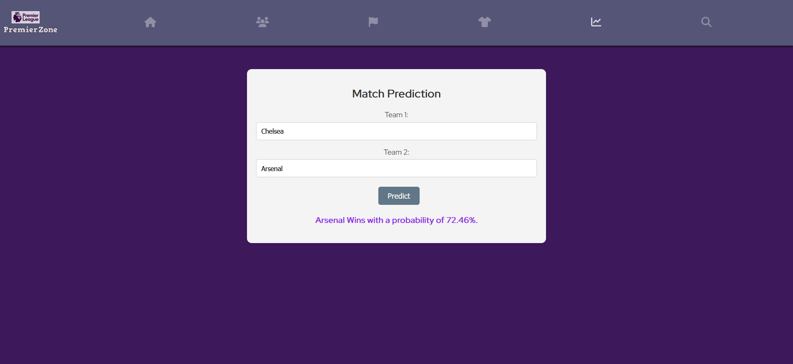

# Premier League Stats & Match Prediction

A web application for browsing Premier League player statistics and predicting match outcomes with an
XGBoost model. It runs locally with Docker Compose: a React frontend, a Spring Boot REST API with
PostgreSQL and a Redis cache, a Python prediction model, and a Kafka pipeline (scraper → Kafka → data
processor → PostgreSQL) for loading new player data.


## Engineering highlights

- **Prediction latency cut from 2.45 s to 0.59 s** (median of 10 requests on one machine) by training the
  model once when the Docker image is built, instead of on every request.
- **Safe process handling**: each prediction runs Python with a 10 s timeout; a process that runs over is
  killed. Unknown or identical teams return **400** with a message, model failures and timeouts return **503**.
- **Target leakage found and fixed**: rolling averages and head-to-head features used the result of the
  match being predicted. After the fix, test accuracy is an honest **0.66 vs 0.62** for a baseline that
  always predicts "not a win" (it was 0.80 with the leak).
- **Redis cache** for player queries, with a 10 minute TTL and eviction of all player caches on every write.
- **Kafka consumer with manual acknowledgment**: the offset is committed only after the player is saved.
- **126 tests in Java, Python and React** (67 backend, 9 data processor, 5 pytest, 45 frontend), run by
  GitHub Actions on every pull request.

## Features

- **Player statistics**: 575 players of the 2022-23 season. Browse by team, position or nationality, or search
  by name. Stats: matches, starts, minutes, goals, assists, penalties, cards, xG and xAG.
- **Player API**: create, update and delete players through the REST API.
- **Match prediction**: enter two teams and get a predicted result with a probability. Team names ignore
  letter case and surrounding spaces, and full names such as "Manchester United" work.



## Architecture

```
┌──────────────┐  player-data  ┌─────────┐       ┌────────────────┐
│ Scraper      │──────────────▶│  Kafka  │──────▶│ Data processor │──┐
│ (Python)     │               └─────────┘       │ (Spring Boot)  │  │
└──────────────┘                                 └────────────────┘  │
                                                                      ▼
┌──────────────┐     HTTP      ┌────────────────┐               ┌────────────┐
│ Frontend     │──────────────▶│ Backend API    │──────────────▶│ PostgreSQL │
│ (React,nginx)│               │ (Spring Boot)  │               └────────────┘
└──────────────┘               │                │──────────────▶┌────────────┐
                               │                │               │   Redis    │
                               │                │──────────────▶└────────────┘
                               └────────────────┘  predict.py (Python process)
```

| Component | What it does |
|---|---|
| `Frontend/` | React app (Create React App, SASS), served by nginx on port 3000. Calls the API at `http://localhost:8080`. |
| `Backend/` | Spring Boot 3.1 / Java 17 REST API on port 8080. PostgreSQL with Flyway migrations, Redis cache, Actuator health checks. Loads the bundled player CSV on startup when the table is empty. |
| `Backend/prediction/` | The model. `train.py` runs during the Docker image build and saves the model; `predict.py` runs once per prediction request. |
| `Backend/data-processor-service/` | Spring Boot Kafka consumer on port 8081. Reads the `player-data` topic and saves players to PostgreSQL. |
| `DataScraping/` | Python scraper (requests, Beautiful Soup) that publishes player stats to Kafka. Optional (compose profile `scraper`). |
| Kafka + Zookeeper | Message broker between the scraper and the data processor. Kafdrop UI on port 8090. |

## Running it

Requirements: Docker with Docker Compose v2.

```bash
docker compose up -d --build
```

or `bash deploy-local.sh`, which also waits for the services and creates the Kafka topics
(`--with-scraper` also runs the scraper, `--help` lists the options).

| Service | URL |
|---|---|
| Frontend | http://localhost:3000 |
| Backend API | http://localhost:8080 |
| Data processor | http://localhost:8081 |
| Kafdrop (Kafka UI) | http://localhost:8090 |

Run the scraper: `docker compose --profile scraper up scraper` (see Limitations).
Start with an empty database: `docker compose down -v` (deletes this project's volumes).

Configuration (set in `docker-compose.yml`): `SPRING_DATASOURCE_URL`, `SPRING_DATASOURCE_USERNAME`,
`SPRING_DATASOURCE_PASSWORD`, `REDIS_HOST`, `CACHE_TTL` (default `10m`), `SPRING_KAFKA_BOOTSTRAP_SERVERS`
(data processor), `KAFKA_BOOTSTRAP_SERVERS` (scraper).

## API

| Method | Path | Description |
|---|---|---|
| GET | `/api/v1/player` | All players |
| GET | `/api/v1/player?team=Manchester-United` | Players of a team, exact name as stored (can be combined with `position`) |
| GET | `/api/v1/player?name=saka` | Search by name (case-insensitive, part of the name) |
| GET | `/api/v1/player?position=FW` | Filter by position (case-insensitive, part of the value) |
| GET | `/api/v1/player?nation=ENG` | Filter by nationality (case-insensitive, part of the value) |
| POST | `/api/v1/player` | Add a player (400 without a name) |
| PUT | `/api/v1/player` | Update a player (404 if not found) |
| DELETE | `/api/v1/player/{name}` | Delete a player |
| POST | `/api/match-prediction` | Predict a match |
| GET | `/actuator/health` | Health of the API, database and Redis |

Prediction example:

```bash
curl -X POST http://localhost:8080/api/match-prediction \
  -H "Content-Type: application/json" \
  -d '{"team1": "Arsenal", "team2": "Chelsea"}'
# {"Result": "<team> Wins" or "Draw", "Probability": <number between 0 and 1>}
# Unknown or identical teams: 400 {"error": "..."}; model failure or timeout: 503
```

## Data

- **Players**: `Backend/src/main/resources/data/prem_stats.csv`, from fbref.com. 2022-23 season, stats up to
  the November 2022 World Cup break (14-15 matches per team). The file has 587 player rows plus 20 "Squad
  Total" rows. 12 players who moved clubs mid-season appear twice, and the name is the primary key, so the
  database holds **575 players**.
- **Matches**: `Backend/prediction/matches.csv`, 1,389 rows (one row per team per match) from September 2020
  to April 2022.

## Prediction model

- XGBoost classifier that predicts whether team1 wins (win vs. draw/loss). Features: home/away, opponent,
  kick-off hour and day, Elo rating, rolling averages of the last 5 matches (goals for/against, shots, shots on
  target) and head-to-head win share.
- Trained on matches from 2021, tested on 282 rows from 2022.
- `train.py` runs during the Docker image build and writes `model/model.json` and `model/teams.json`.
  `predict.py` only loads them, so a request no longer retrains the model (2.45 s → 0.59 s median; most of
  the remaining time is importing pandas and XGBoost).
- **Leakage fix**: the rolling averages included the match being predicted and the head-to-head share used
  all matches, including later ones. Now rolling averages use only earlier matches (`shift(1)`) and
  head-to-head only matches before the date.

| | Accuracy (2022 test set) | Precision |
|---|---|---|
| Before the leakage fix | 0.80 | 0.74 |
| After the leakage fix | **0.66** | 0.57 |
| Baseline: always "not a win" | 0.62 | – |

The API turns the win probability into a label: "Draw" when it is between 0.45 and 0.55, "team1 Wins" above,
"team2 Wins" below. Team1 is treated as the home team.

## Tests and CI

| Suite | Tool | Tests |
|---|---|---|
| Backend | JUnit 5, Spring Boot Test, H2 | 67 |
| Data processor | JUnit 5, Mockito, `@DataJpaTest` on H2 | 9 |
| Prediction model | pytest | 5 |
| Frontend | Jest, React Testing Library | 45 (12 suites) |

The Java prediction tests start a small fake predictor process instead of Python, so they test the process
handling (result, 400, 503, timeout and kill) without the model. The Python script is tested with pytest.
The backend tests need no Docker, PostgreSQL or Redis.

```bash
cd Backend && ./mvnw test                                        # backend
cd Backend && ./mvnw -f data-processor-service/pom.xml test       # data processor
cd Backend/prediction && pip install -r ../requirements-dev.txt \
  && python train.py && python -m pytest tests                    # prediction model
cd Frontend && npm ci && npm test -- --watchAll=false             # frontend
```

GitHub Actions (`.github/workflows/ci-cd-pipeline.yml`) runs 5 jobs on every pull request and on pushes to
`main` and `develop`: backend tests, data processor tests, prediction tests, frontend tests and production
build, and a build of all 4 Docker images. It does not deploy anything.

## Limitations

- **The scraper is blocked**: fbref.com answers 403 Forbidden, so the database is filled from the bundled CSV.
  The Kafka → data processor → PostgreSQL path was checked by hand with a test message sent to the
  `player-data` topic.
- **Old data**: players from 2022-23 (until November 2022), matches until April 2022.
- **Elo leak**: most matches appear twice (once per team), so Elo is updated twice per match, and the second
  row already includes that match's result. Not fixed yet.
- The model predicts win vs. not-win; "Draw" and "team2 Wins" are derived from that one probability.
- One Python process per prediction request.
- The frontend calls `http://localhost:8080` directly, so it only works locally.
- `npm audit` reports known vulnerabilities in frontend dependencies. They are not force-fixed because
  that needs breaking upgrades.
- Runs locally only; there is no cloud deployment.

## Tech stack

- **Frontend**: React 18, React Router, SASS, axios, Font Awesome, nginx
- **Backend**: Java 17, Spring Boot 3.1 (Web, Data JPA, Cache, Actuator), PostgreSQL 15, Flyway, Redis 7.4
- **Messaging**: Apache Kafka (Confluent 7.4), Spring Kafka, Kafdrop
- **Machine learning**: Python, pandas, scikit-learn, XGBoost
- **Scraping**: Python, requests, Beautiful Soup, kafka-python
- **Tooling**: Docker, Docker Compose, GitHub Actions, Maven, JUnit 5, Mockito, Jest, pytest
